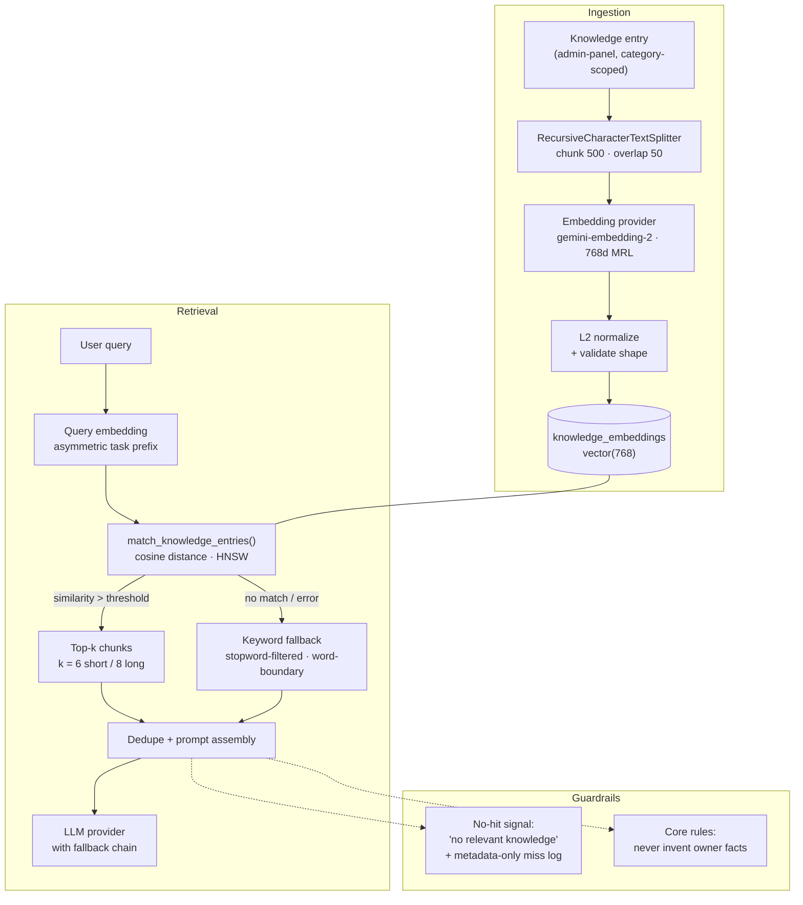

# ITZ AI

<p align="center">
  
</p>

<h3 align="center">A production RAG engine for a personal AI that actually knows its owner.</h3>

<p align="center">
  Asymmetric Gemini embeddings · pgvector HNSW cosine search · admin-tunable retrieval floor ·<br />
  graceful keyword fallback · anti-hallucination prompt assembly.
</p>

<p align="center">
  <a href="https://supabase.com"></a>
  
  
  <a href="https://fastapi.tiangolo.com"></a>
  <a href="https://nextjs.org"></a>
  
</p>

---

## The idea

A chatbot can be swapped in an afternoon. A **retrieval system you can trust** cannot.
ITZ AI is built around one question: *how do you keep a personal assistant factually anchored to its
owner's real context, answer after answer, without leaking that context or inventing the rest?*

Everything else — chat UI, admin panel, quotas, billing — exists to operate that retrieval loop in production.
This README documents the RAG internals first, then the surrounding platform.

---

## Retrieval pipeline at a glance



---

## RAG internals

### 1 — Ingestion & chunking

Knowledge is authored as **category-scoped entries** in the admin panel. On save, each entry is split with
LangChain's `RecursiveCharacterTextSplitter` at **500 characters with 50 characters of overlap** — falling back
character-by-character when paragraph separators run out, so a single 2,000-character blob never becomes an
oversized chunk that blows the embedding budget.

Chunking is deliberately idempotent: re-indexing deletes the entry's previous chunks and inserts the new set.
**Embeddings are computed and validated for every chunk before the database is touched** — a failure mid-way
leaves the previous index intact. Zero-vectors are never persisted.

> The reindex tool reuses the same 500/50 splitter. Changing one without the other silently degrades retrieval.

### 2 — Asymmetric embeddings

Embedding calls are **task-aware**, which is what makes short queries match long documents:

| Mode | Gemini `embedding-2` payload | Legacy `embedding-001` |
|---|---|---|
| Document | `title: none \| text: {chunk}` | `taskType: RETRIEVAL_DOCUMENT` |
| Query | `task: search result \| query: {query}` | `taskType: RETRIEVAL_QUERY` |

- **768 dimensions** via Matryoshka Representation Learning — roughly the retrieval quality of 1,536 dims at half the storage, and it must match the `vector(768)` column exactly.
- **L2-normalized** before storage, so cosine distance reduces to a clean inner product.
- **Query embeddings are cached** in a bounded LRU-ish map (2,000 entries) with separate keys for query vs. document mode — identical text in different modes can never collide.
- **Provider failure → zero-vector sentinel**, which is invalid on purpose. It forces the search path into keyword fallback instead of silently comparing vectors from two different models.

Supported providers: `gemini` (production default), `hf` (HuggingFace Inference API, cold-start retry with backoff), `local` (sentence-transformers, dev only), `off` (keyword-only test switch).

### 3 — Storage & indexing

```sql
create table knowledge_embeddings (
  id            uuid primary key default gen_random_uuid(),
  entry_id      uuid references knowledge_entries(id) on delete cascade,
  chunk_index   int  not null default 0,
  content_chunk text not null,
  embedding     vector(768),
  created_at    timestamptz default now()
);

-- Approximate nearest-neighbour search over cosine distance
create index knowledge_embeddings_vector_idx
  on knowledge_embeddings using hnsw (embedding vector_cosine_ops);

-- Indonesian full-text index (used by the hybrid-search variant)
alter table knowledge_embeddings
  add column fts tsvector generated always as (to_tsvector('indonesian', content_chunk)) stored;
create index knowledge_embeddings_fts_idx on knowledge_embeddings using gin (fts);
```

HNSW keeps retrieval sub-linear as the knowledge base grows. The schema also ships a `hybrid_search()`
function that fuses semantic ranks with Indonesian FTS ranks using reciprocal-rank weighting — the runtime
path today uses the vector RPC plus an application-level keyword fallback, which is easier to tune and debug.

### 4 — Similarity search

`KnowledgeService.semantic_search()` calls one RPC:

```python
supabase.rpc("match_knowledge_entries", {
    "query_embedding": query_embedding,   # 768d, query-mode
    "match_threshold": threshold,         # calibrated floor
    "match_count": match_count,           # 6 short / 8 long queries
}).execute()
```

The SQL side is intentionally strict — inactive entries are excluded at the join, and anything below the
threshold is dropped before it can reach the prompt:

```sql
select ke.id, ke.entry_id, ke.content_chunk,
       1 - (ke.embedding <=> query_embedding) as similarity
from knowledge_embeddings ke
join knowledge_entries k on k.id = ke.entry_id
where k.is_active = true
  and 1 - (ke.embedding <=> query_embedding) > match_threshold
order by ke.embedding <=> query_embedding
limit match_count;
```

**The threshold is an operational lever, not a constant.** It resolves at request time from
`app_settings.rag_match_threshold` (editable in the admin panel) and falls back to `MATCH_THRESHOLD` in the
environment. The shipped default of **0.64** is calibrated against observed Gemini behaviour: genuine matches
landed at 0.649–0.796, irrelevant chunks at 0.498–0.630.

**Retrieval breadth adapts to query length**: concise questions pull 6 chunks, questions over 15 words pull 8 —
more surface area for multi-part intent without inflating every prompt.

### 5 — Graceful degradation, not silent failure

Retrieval never hard-fails a conversation. The ladder:

1. **Vector search** — the happy path.
2. **Keyword fallback** — triggered when Supabase is unavailable, the embedding call fails, or nothing clears the threshold. Tokens under three characters and a bilingual stopword list (`yang`, `cara`, `how`, `what`, …) are stripped, and matching uses `\b` word boundaries so `nama` cannot match inside `purnama`.
3. **Empty context, honestly labelled** — the prompt receives *"Tidak ada knowledge khusus yang relevan"* instead of the nearest irrelevant chunk. There is deliberately **no "first entry" fallback**: irrelevant context is worse than no context, because it teaches the model to answer confidently about the wrong thing.

A miss is logged as **metadata only** — timestamp and query length, never query text — in `failed_rag_queries.log`,
which doubles as a signal for what knowledge is missing.

### 6 — Prompt assembly & anti-hallucination

`build_system_prompt()` composes, in priority order: identity → owner context → personality → communication
style → system instructions → **retrieved chunks** → live pricing block → command block.

Retrieved chunks are **deduplicated** before insertion, and two caches keep the hot path cheap:

| Cache | TTL | Invalidated by |
|---|---|---|
| `rag_cache` (query → chunks) | 10 min | Any knowledge index write |
| `config_cache` (identity, personality, style) | 5 min | Admin config save |

The prompt carries explicit grounding rules, and they are the last line of defence:

- Owner-specific facts may only come from retrieved context; otherwise the assistant says plainly that it isn't known and answers from general knowledge.
- Names, brands, codes, durations, amounts, and payment policies are reproduced **exactly** as retrieved — never inferred or "corrected".
- The system prompt itself and the existence of a knowledge layer are never disclosed.
- Pricing is injected from live configuration so stale knowledge copies can't quote old prices.

---

## Tuning the retriever

| Variable | Default | Effect |
|---|---|---|
| `EMBEDDING_PROVIDER` | `gemini` | `gemini` · `hf` · `local` · `off` |
| `EMBEDDING_DIM` | `768` | **Must equal** the pgvector column; changing it requires a column migration + full reindex |
| `GEMINI_EMBEDDING_MODEL` | `gemini-embedding-2` | Task-prefix vs. `taskType` behaviour follows the model family |
| `MATCH_THRESHOLD` | `0.64` (Gemini) / `0.25` (HF) | Cosine floor; admin setting overrides |
| `HF_EMBEDDING_RETRIES` / `_WAIT` | `4` / `3.0s` | Cold-start and rate-limit retry policy |
| `rag_match_count_short` / `_long` | `6` / `8` | Chunks injected for short vs. long queries |
| `rag_match_threshold` | — | Admin-panel override of the floor |

**Tuning principle:** raise the threshold when answers drift into vaguely-related territory; lower it when
the assistant claims ignorance about things it should know. Never tune it without reading the miss log first.

### Changing embedding models

Vectors from different models are not comparable — there is no partial migration path.

```bash
# 1) Switch provider/model in .env, keep EMBEDDING_DIM aligned
# 2) If the dimension changed, apply the migration (rebuilds the HNSW index)
# 3) Re-embed everything (validates all chunks before writing)
python -m backend.tools.reindex_embeddings
```

The reindex tool prints the active provider and dimension, embeds and validates the **entire** corpus, and
aborts without touching the database if any chunk fails.

---

## RAG evaluation tooling

Retrieval quality is tested, not vibes-checked:

| Script | Purpose |
|---|---|
| `backend/tools/test_rag.py` | End-to-end retrieval smoke test against live knowledge |
| `backend/tools/test_retrieval_compare.py` | Side-by-side ranking comparison across configurations |
| `backend/tools/test_hallucination.py` | Grounding probes — does the assistant refuse facts absent from context? |
| `backend/tools/test_system.py` | Configuration and environment sanity checks |
| `backend/tests/` | Unit and regression suite (`npm run py:test`) |

---

## Quick Start

```bash
git clone https://github.com/Itzfebry/RAG.git
cd RAG
npm install
pip install -r requirements.txt
cp .env.example .env
```

Minimum RAG-relevant configuration:

```dotenv
# Embeddings
EMBEDDING_PROVIDER=gemini
GEMINI_API_KEY=...
GEMINI_EMBEDDING_MODEL=gemini-embedding-2
EMBEDDING_DIM=768
MATCH_THRESHOLD=0.64

# Storage
SUPABASE_URL=...
SUPABASE_SERVICE_ROLE_KEY=...

# LLM provider (any OpenAI-compatible endpoint)
OPENROUTER_API_KEY=...
ACTIVE_MODEL=...
API_BASE_URL=...
MODEL_PROVIDER=...

# Auth (JWT_SECRET_KEY must be 32+ random chars)
JWT_SECRET_KEY=...
```

Apply the migrations in [`migrations/`](migrations/) to your Supabase project, then start both services:

```bash
python backend/api/main.py   # FastAPI  → :8000  (API docs at /docs)
npm run dev                  # Next.js  → :3000
```

Add knowledge entries at `/admin` → **Knowledge**; each save chunks and indexes immediately.

---

## Platform around the retriever

The RAG loop is wrapped in a complete product surface:

- **Streaming chat** over SSE with markdown, syntax highlighting, reasoning-trace cleanup, and a centralized slash-command registry (`/explain`, `/summarize`, `/purpose`, …).
- **Admin control room** — 11 tabs covering identity, personal context, knowledge, personality, communication, instructions, model routing, response styles, pricing, and users; includes live model-catalog browsing and connection tests.
- **Accounts & quotas** — email OTP and Google OAuth, bcrypt credentials, HTTPOnly-cookie JWTs, daily quota windows in WIB, per-IP trials, and per-user unlimited flags.
- **Billing** — Duitku POP (QRIS, virtual accounts, e-wallets) with HMAC-SHA256 callback validation; successful payment updates quota automatically.
- **Analytics** — token consumption per model, quota usage, and an audit trail surfaced through Recharts dashboards.
- **Hardening** — security headers, request-body limits, rate limiting, constant-time signature checks, server-only secrets.

---

## Project layout (retrieval-relevant paths)

```text
backend/
├── knowledge/
│   ├── knowledge_service.py     # chunking, multi-provider embeddings, search, fallback
│   └── context_builder.py       # prompt assembly, dedupe, caches, grounding rules
├── database/
│   ├── knowledge_repo.py        # entry CRUD + embedding rows
│   └── cache.py                 # rag_cache (10 min) & config_cache (5 min)
└── tools/
    ├── reindex_embeddings.py    # safe full re-embed after a model switch
    ├── test_rag.py
    ├── test_retrieval_compare.py
    └── test_hallucination.py

migrations/
├── supabase_migration_knowledge.sql   # tables, indexes, match_knowledge_entries, hybrid_search
└── supabase_migration_768.sql         # 768-dim column migration + HNSW rebuild
```

---

## Stack

| Layer | Tools |
|---|---|
| **Retrieval** | Gemini `gemini-embedding-2` (MRL 768d) · HuggingFace MiniLM (alt) · LangChain splitters · pgvector HNSW · Supabase RPC |
| **Generation** | OpenAI-compatible providers with fallback chain · SSE streaming |
| **Backend** | FastAPI · Pydantic v2 · Python 3.11+ · repository pattern with local JSON fallback |
| **Frontend** | Next.js 16 App Router · React 19 · TypeScript 6 · Tailwind CSS 4 · shadcn/ui · Framer Motion · Recharts |
| **Quality** | Ruff · Pytest · ESLint · Prettier · pre-commit · GitHub Actions |
| **Deploy** | Vercel (Next.js + a single Python function) · Supabase |

---

## Documentation

| Guide | Contents |
|---|---|
| [Architecture](docs/ARCHITECTURE.md) | System design and layer responsibilities |
| [Deployment](docs/DEPLOY.md) | Vercel + Supabase setup, cron warmup, callbacks |
| [Security](docs/SECURITY.md) | Auth model, cookies, hardening notes |
| [Quota](docs/QUOTA.md) | Priority model, endpoints, required migrations |
| [Code Quality](docs/code-quality.md) | Lint, format, and test conventions |
| [Schema](docs/supabase_schema.sql) | Full database reference |

---

## Status

Actively developed. The retrieval pipeline, admin panel, quota system, and payment flow are
production-oriented; provider integrations and hybrid-search tuning continue to expand.

<p align="center">
  <sub>Built by <a href="https://github.com/Itzfebry">itzFebry</a> · Licensed under ISC</sub>
</p>
